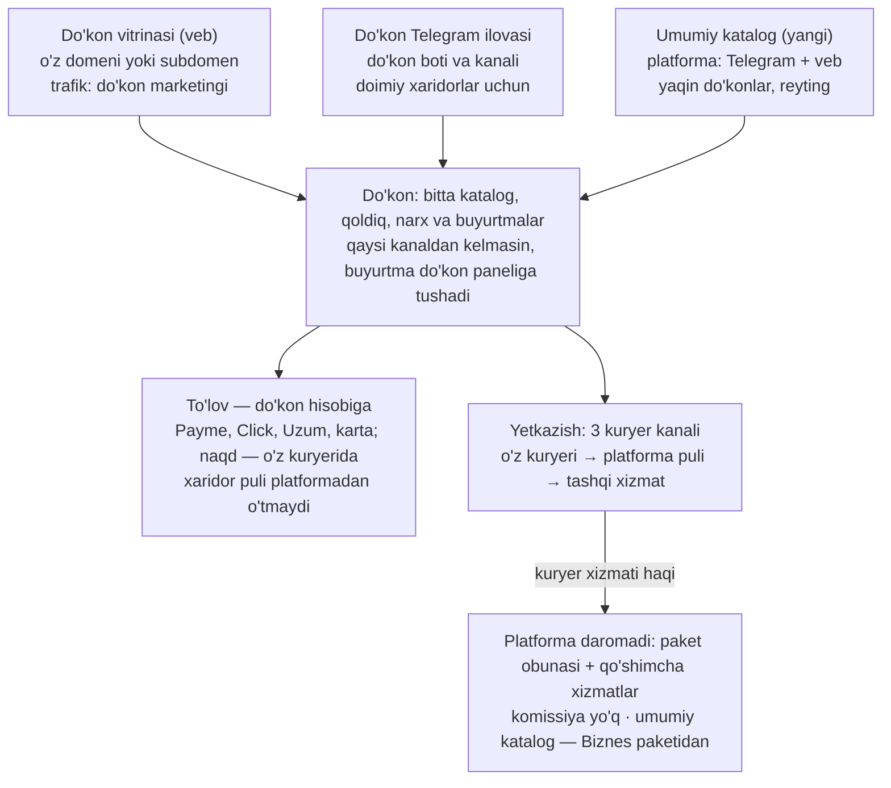
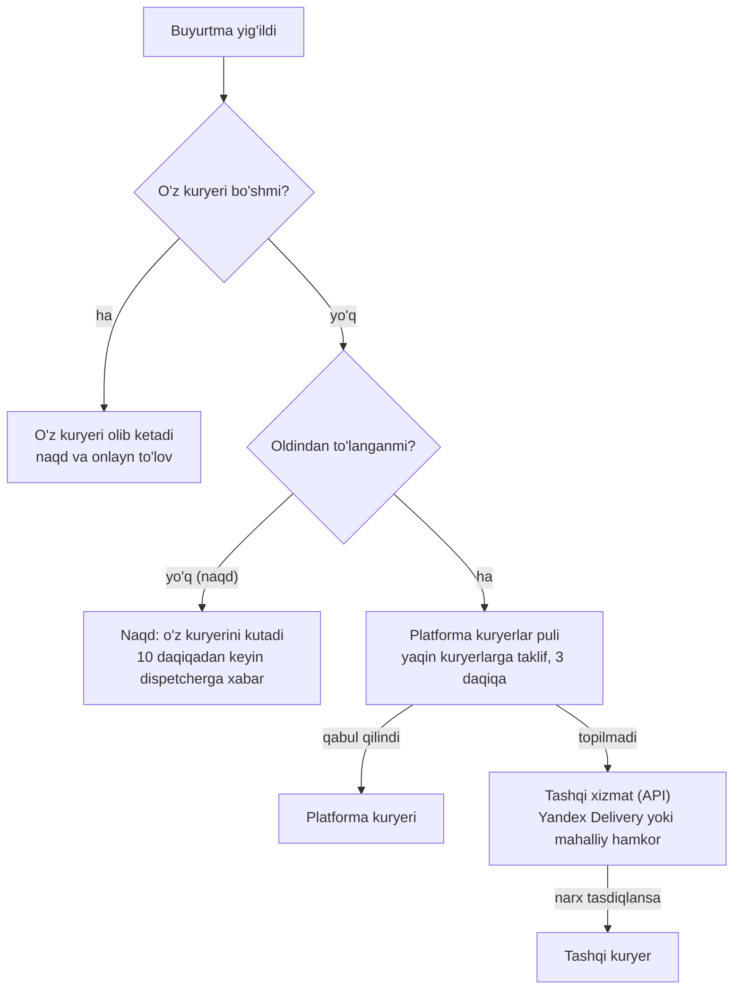
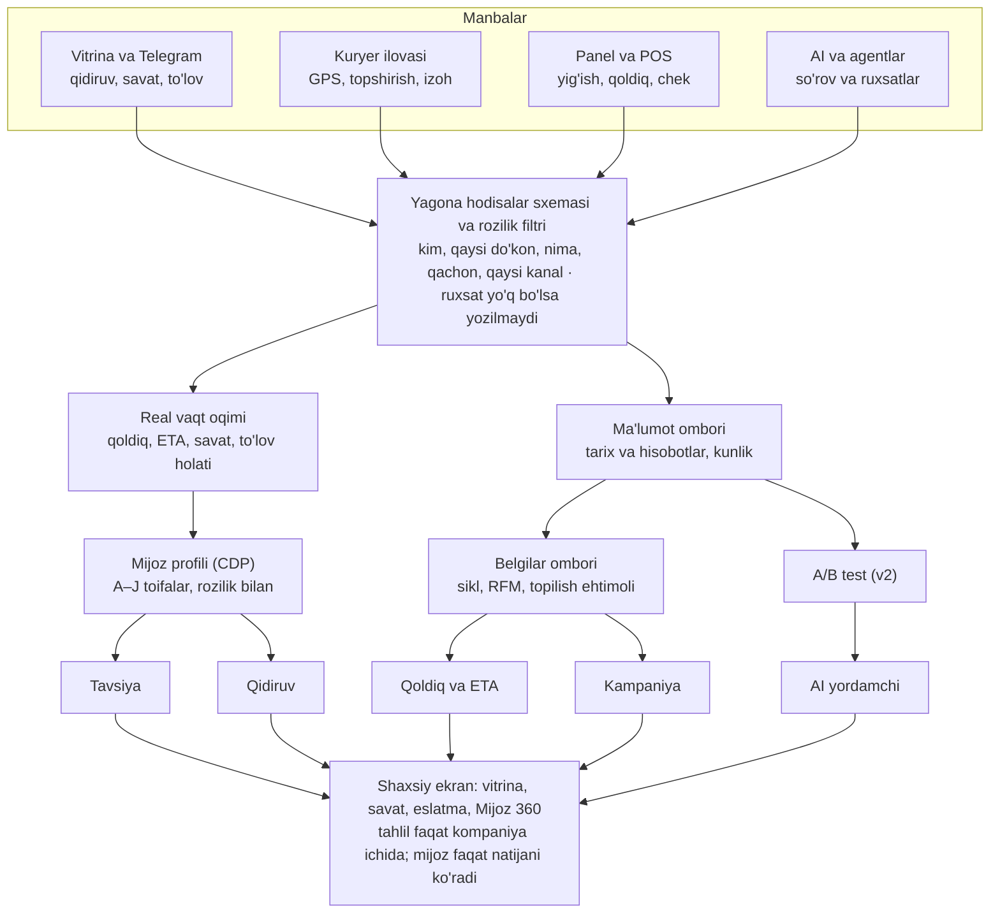
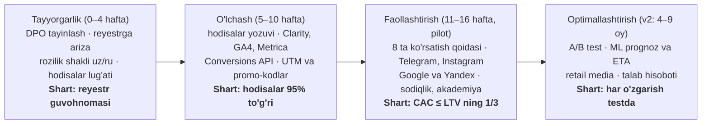

# Diagrammalar (Mermaid)

Onlayn hujjatlardagi 5 ta chizma eksportda tushib qolgani uchun bu yerda matnli (Mermaid) ko'rinishda qayta berilgan. Mazmuni onlayn versiya bilan bir xil.

## 1. Gibrid model: uch kirish kanali, bitta do'kon

PRD, "Gibrid model" bo'limi.

## 2. Kuryer tanlash tartibi

PRD, "Kuryer muammosi yechimi" bo'limi. Har kanal do'kon sozlamasida yoqiladi/o'chiriladi; o'chiq kanal tashlab o'tiladi.

Pilotda platforma kuryerlar puli o'chiq (yurist xulosasigacha) — u holda zanjir: o'z kuryeri → tashqi xizmat.

## 3. Ma'lumot arxitekturasi: 6 qatlam

"Mijoz ma'lumotlari: 33 kompaniya" hujjati, "Texnik asos" bo'limi.

Asosiy baza O'zbekistonda (bizning tanlov); tashqi AI modelga shaxsiy ma'lumot yashirilgan holda boradi.

## 4. SWOT

"Data va reklama strategiyasi", "Kuchli va zaif tomonlar".

| | Yordam beradi | Xalaqit beradi |
| --- | --- | --- |
| **Ichki** | **Kuchli:** o'z ma'lumotimiz (buyurtma, qidiruv, GPS); do'kon, kuryer, to'lov bitta tizimda; uz/ru, Telegram, mahalliy to'lovlar; POS/ERP bilan ham, ularsiz ham ishlaydi; har do'konga o'z brendli do'koni | **Zaif:** yangi brend, ishonch hali shakllanmagan; boshida ma'lumot kam, ML uchun yetmaydi; do'konlarda marketing ko'nikmasi past; kuryerlar do'konniki — sifat har xil; kichik jamoa, data mutaxassisi kam |
| **Tashqi** | **Imkoniyatlar:** internet 89%, Instagram qamrovi 14,1 mln; 2026: ma'lumot qonuni yumshadi; Apple/Google Pay, AI agent savdosi; retail media, anonim talab hisoboti; viloyatlarda onlayn raqobat hali kam | **Xavflar:** Uzum, Korzinka GO va marketpleyslar; Meta va Google reklama narxi o'sishi; qonun va soliq talablari o'zgarishi; ma'lumot sizib chiqsa — ishonch yo'qoladi; tajribali kuryer va xodim yetishmasligi |

## 5. Data va reklamani joriy etish rejasi (4 bosqich)

Har bosqichning oxirgi qatori — keyingi bosqichga o'tish sharti.

